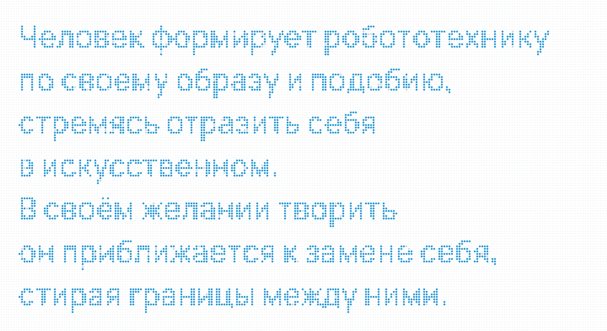

<picture><source media="(prefers-color-scheme: dark)" srcset="assets/quote-dark.svg"></picture>

### Hey, I'm Fyodor 👋

Co-founder of [**GramGPT**](https://gramgpt.io) — Telegram account automation platform
(AI commenting, reactions, warming, marketplace). Backend, frontend, infra — all of it.

**Stack:** Python · Django · Telethon · Redis Streams · Nuxt/Vue · TypeScript · Go · Docker

### Projects

| | |
|---|---|
| [gramgpt-claude-plugin](https://github.com/atljh/gramgpt-claude-plugin) | Run GramGPT Telegram accounts from Claude Code — MCP + skills |
| [GhostMove](https://github.com/atljh/GhostMove) | Real-time chess position analyzer from screen, Go + Stockfish |
| [Codemancer](https://github.com/atljh/Codemancer) | Command deck for AI-native engineering, Tauri desktop app |
| [TeleGen](https://github.com/atljh/TeleGen) | AI content generation for Telegram channels, Django |
| [VideoUniqueizer](https://github.com/atljh/VideoUniqueizer) | Batch video uniqueization — overlays, watermarks |
